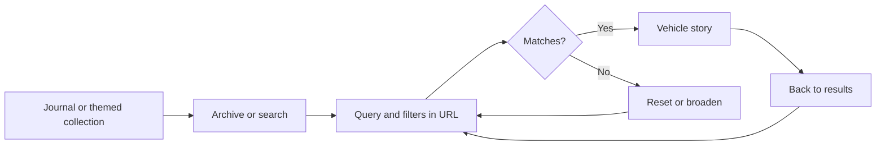
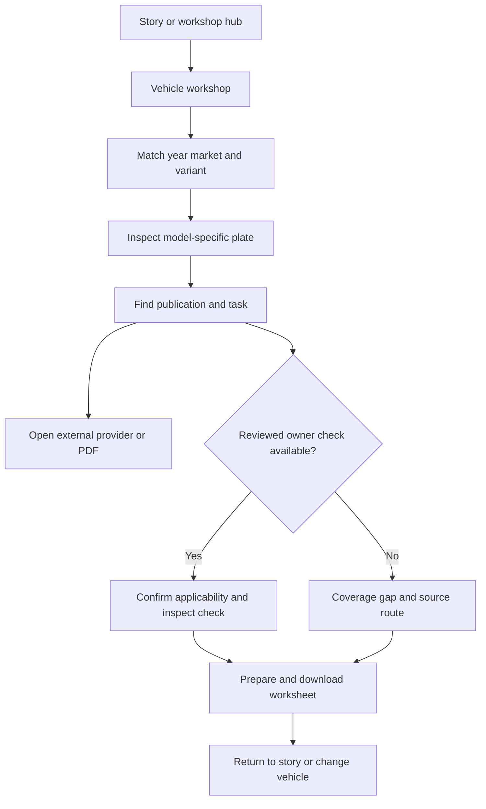
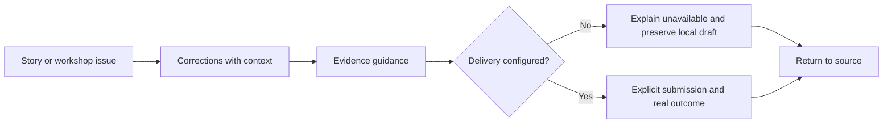

# MOTOR / ARCHIVE experience contract

## Foundation

Responsive web publication, built with custom React components, Next-style routing and Tailwind CSS. No inherited component-library behavior is assumed. `DESIGN.md` is the visual identity reference; references such as `{colors.paper}` resolve there. The current site is a private sample preview with four catalogue cars. This contract covers public reading and workshop flows, not a production certification or a repair manual.

The source audit on 20 October 2026 establishes implementation facts. Items labeled **Implemented** describe repairs included in the local website. The verification section and UX-AUDIT.md record browser coverage and remaining limits. No interviews, analytics, user tests or validated personas were supplied. Named actors below are explicitly hypothetical assumptions.

## Information Architecture

| Surface | Entry and purpose | Flow coverage |
|---|---|---|
| Journal `/` | Main navigation; editorial discovery, featured cars and workshop teaser | Discovery |
| Archive `/archive`, search `/search` | Navigation/search icon; query, filters, ordering and car selection | Discovery |
| Vehicle `/cars/[slug]` | Editorial card; five story chapters, sources, photos and workshop | Discovery, Workshop, Gallery, Correction |
| Motorsport, design, photo archive, collections | Navigation or cards; themed discovery into stories | Discovery |
| Workshop `/workshop` | Navigation; choose the correct vehicle | Workshop |
| Vehicle workshop `/cars/[slug]/workshop` | Story CTA or workshop list; applicability, plate, manuals, tasks, checks and worksheet | Workshop, Correction |
| Gallery/plate dialog | Photograph or technical-plate enlarge control; inspect detail | Gallery, Workshop |
| Newsletter `/newsletter` and inline panel | Header/footer/inline panel; honest availability and subscription | Newsletter |
| Corrections `/corrections`, contact `/contact` | Story/workshop/footer; evidence guidance and channel status | Correction |
| About, editorial policy, image credits, privacy, terms | Footer and source references; provenance and publishing context | Provenance extension of Discovery |
| Error and 404 | Failed load or unknown address; retry or return to archive | All flows, recovery |

Every core need has a listed entry surface. External publisher access and an unconfigured editorial inbox remain real boundaries, not concealed in-site functionality. Editorial desk is an operational surface outside this public-flow audit.

## Voice and Tone

Use precise actions, ordinary language and the approved publication voice. Never use em dashes. Remove Vol 01 wherever it remains. Differentiate an owner handbook, a service manual, a provider enquiry and a downloadable worksheet.

| Situation | Contract microcopy |
|---|---|
| Unavailable newsletter | “Signups are not open yet. The email service has not been connected.” Show before collecting input. |
| External literature | Identify provider, publication, market/year coverage and paid/free access before the link. |
| Missing procedure | “Step-by-step instructions are not yet available for this car.” Offer task sources and worksheet. |
| Local worksheet | “Nothing entered here is sent to a server.” Also state when entries will be lost. |
| Correction channel unavailable | “Reports cannot be submitted through this preview.” A local draft must never say “sent.” |
| Search empty | State that no stories match and offer a visible reset. |

## Component Patterns

Visual specifications live in `DESIGN.md.Components`.

| Component | Behavior and acceptance |
|---|---|
| Site navigation | Standard links support Back and new tabs. Menu exposes expanded state, closes on navigation and is operable without hover. Active indication must identify the actual context; vehicle workshops should not appear as general story reading. |
| Editorial card | Whole card opens one story. Accessible name contains vehicle identity. Historic image crops retain the subject. |
| Archive controls | Query, selects, ordering and page form one state. **Implemented:** serialize valid values in URL, restore on Back/reload, reset page after query/filter changes and announce result counts. Expanded filters expose aria-expanded and their controlled region. |
| Story chapters | Anchors scroll to visible chapter headings; workshop CTA names the current car. **Implemented:** preserve the originating filtered collection through browser Back. |
| Gallery dialog | Open focuses close, locks background scroll and traps all focusable descendants, including credits links. Arrows change photo without reinitializing focus; Escape/close restores the initiating thumbnail. **Implemented:** lifecycle depends on open/closed, not image index. |
| Technical plate | Select plate by vehicle slug. Enlarge starts at 100%; zoom steps 50%, clamps 100% to 300%; Fit width resets. Internal viewport can scroll by keyboard/touch. **Implemented:** include the focusable image viewport in focus containment. |
| Manual library | Search and type filters update visible resources and live count. External links open clearly identified provider destinations. No results offers recovery. Keep coverage/access visible; never imply a purchase occurred. |
| Owner check | No tasks shows an honest coverage gap. Available NSX checks require explicit year/market confirmation before revealing checklist. Changing applicability clears session checkmarks. Opening original source does not require checking the confirmation. |
| Service worksheet | Download a vehicle-specific plain-text draft using current fields and source links. No network submission. Entries are session/page state; make loss on navigation explicit. |
| Newsletter | When provider is absent, show unavailable state before fields. When available, validate email/consent, prevent duplicate pending submits, preserve input on error and report confirmation-email status without claiming subscription is confirmed. |
| Correction report | Collect or explain URL, claim, proposed correction, evidence and applicable vehicle details. **Implemented:** provide a useful local draft or clear return path while delivery is unavailable. Never send without explicit authorization or invent an inbox. |
| Recovery panel | Server-rendered error offers retry; unknown route offers archive. Preserve context where practical. Avoid success language when a resource is missing. |

## State Patterns

| Surface | States and recovery |
|---|---|
| Journal/themed pages | Cold load renders content or normal error boundary. Missing image must not erase caption/navigation. Empty collection routes back to archive. |
| Archive/search | Default, expanded filters, filtered, no matches, page boundary, restored URL and reset. Unknown parameter values are ignored safely. No fabricated offline results. |
| Vehicle story | Known slug, missing slug (404), image failure and long-page anchor navigation. Sources and workshop link remain usable when an image fails. |
| Workshop hub/file | Valid vehicle, empty literature, missing task, coverage gap, matching applicability and external-provider failure. Provider failure is outside local control; local page remains available. |
| Gallery dialog | Closed, first/last image with wrap, failed image, keyboard focus and Escape dismissal. Image counter is announced without moving focus. |
| Technical plate | Closed/open, 100%/intermediate/300%, focused scroll viewport and failed image. Disabled zoom boundary controls match actual value. |
| Manual library | Full set, filtered set and zero matches; count updates politely. |
| Owner check | Unconfirmed, confirmed, partial checklist and cleared confirmation. No persistence promise. |
| Service worksheet | Empty, populated, downloaded draft and departure. Download is not completed maintenance. |
| Newsletter | Unconfigured, ready, invalid, pending, confirmation email requested, network/provider failure and rate limit. Unconfigured state must not collect input unnecessarily. |
| Correction/contact | Unconfigured channel, local draft if implemented, and return to source. No sent/saved-to-editorial state without backend support. |
| Policy/provenance pages | Readable normal state, outbound source unavailable and fallback navigation. |
| Global | Keyboard focus, reduced motion, offline/network failure, server error and 404. This implementation has no offline cache contract. |

## Interaction Primitives

Use links for navigation and buttons for local state changes. Enter submits a form; Space toggles checkboxes/buttons. Native selects keep platform keyboard support. Gallery supports Left/Right and Escape only while open; do not hijack these keys from unrelated page controls. Modal focus containment must include links and tabindex elements, and restore the exact opener once on dismissal. One modal at a time.

In-page navigation must leave target content below any sticky navigation. Back/Forward restores discovery context. Downloads are initiated by an explicit user button. External source links preserve the in-site page. Share reports clipboard failure with a usable manual-copy instruction.

## Accessibility Floor

Target WCAG 2.2 AA; this is a requirement, not an audit certification. Use the existing skip-to-main link and a single page h1. Give every interactive element a programmatic name and visible focus using adequate `{colors.accent}` contrast. Form labels must have unique IDs when components repeat. Communicate results, submit outcomes and counters with polite status regions, avoiding repeated announcements while typing.

Trap focus across every focusable modal child, include the plate's scroll viewport, keep background content unavailable while modal is open and restore focus to the initiating control. Close, zoom and gallery controls must remain reachable at narrow widths and 200% text zoom. Practical target is 44px touch controls; verify exceptions rather than claiming blanket compliance. Respect prefers-reduced-motion. Alt text identifies the specific car and whether the visual is a historic photo or technical drawing. Captions/credits remain available outside imagery. Contrast requirements and the orange-on-ivory limitation live in DESIGN.md.

## Responsive & Platform

At widths up to 760px stack article/workshop columns, expose the menu and wrap metadata. Intermediate rules at 1000px/1120px reduce gaps and navigation pressure. Avoid page-level horizontal scrolling; zoomed technical drawings scroll only in their viewer. A worksheet keyboard should not cover the active field/action. The long story must still provide chapter and workshop navigation on phones. Desktop can retain asymmetric spreads and a workshop contents rail.

## Inspiration & Anti-patterns

The supplied period workshop dimension sheet establishes the desired visual category: a recognizable car with multiple views and technical detail. It does not authorize pretending a reference drawing is a reviewed service operation. The user rejected encyclopedia-like presentation, generic repeated car silhouettes, missing image loads and em dashes. Preserve the approved historic-photo magazine direction while fixing behavior.

## Key Flows

All protagonists in this section are **[ASSUMPTION] hypothetical journey actors**, not interview participants or researched personas.

### Discovery: Asha finds a car and returns

1. Asha enters Journal and follows The cars, or opens a themed collection.
2. She enters “Porsche,” adjusts a filter and sorts; the result count changes.
3. She opens the Porsche story and moves through chapters and sources.
4. **Climax:** Back to results restores her query, filters, ordering and page, so the next comparison starts where she left off.
5. She resets filters to broaden discovery; policy or image-credit links provide provenance when needed.

Failure: no matches gives reset; missing story gives archive recovery. Source audit found local-only state, so step 4 is an acceptance target pending parent fixes.

### Workshop: Ravi prepares the correct job

1. Ravi reads a vehicle story and opens that car's workshop; alternatively he chooses the car at the workshop hub.
2. He checks model year, market and engine against the applicability list.
3. He opens the car-specific plate, zooms, closes it and filters the manual library.
4. He follows a clearly identified publisher listing or original PDF. A task points to the corresponding source section.
5. Where instructions exist, he confirms applicability before opening an owner check; otherwise he sees the coverage gap.
6. **Climax:** Ravi downloads a vehicle-specific preparation worksheet with his configuration, intended job and source links, without mistaking it for a repair procedure.
7. The story link or Change vehicle action takes him back to a known context.

Failure: unavailable/paid manual remains labeled; an unsupported variant must not reveal assumed instructions. A downloaded worksheet does not certify work as completed.

### Gallery: Noor inspects photographs by keyboard

1. Noor tabs to a story photograph and opens it.
2. Close receives focus; the background stops scrolling.
3. Noor advances with arrows and reaches credit links through Tab without leaving the dialog.
4. **Climax:** Escape closes the image and restores the exact thumbnail, so reading continues without losing place.

Failure: a failed image retains counter, close and credits. The source audit found index-dependent focus effects and incomplete focusable selection; parent QA must verify the corrected lifecycle.

### Newsletter: Mina understands availability before giving details

1. Mina follows The Sunday letter.
2. With no provider configured, she sees that signup is unavailable before entering an email.
3. **Climax:** She can return to the archive with an accurate understanding that no subscription was made.
4. In a configured deployment, email and consent lead to pending confirmation, then a confirmation-email message; the confirmation link completes subscription separately.

Failure: network or provider error preserves inputs and invites retry. The source API truthfully returns 503 when unconfigured, but the original form revealed this too late.

### Correction: Arun preserves an evidence-backed report

1. Arun finds a questionable claim and follows the story/workshop correction link.
2. The source URL and vehicle context are retained where supplied.
3. He reads the required evidence and the unconfigured channel notice.
4. **Climax:** A local draft export, if implemented, preserves his claim, proposed correction and references without falsely claiming delivery.
5. A clear return action restores the source story or workshop.

Failure: no channel means no submission. Source audit found guidance only with no draft or contextual return, so steps 2, 4 and 5 are proposed acceptance behavior pending implementation.

## Implementation verification

The local repair pass is complete. See `../../../../UX-AUDIT.md` for specific browser checks, test counts and deferred configuration. Implemented rows above describe the delivered behavior; the audit records which paths were exercised. Browser Back is the implemented shortlist return mechanism.
